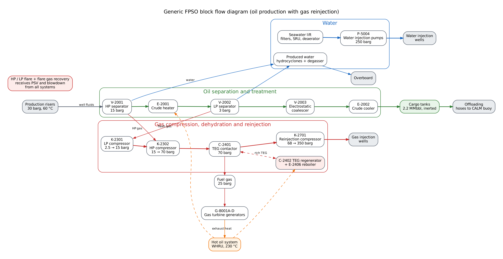

# Summary

- A typical deepwater FPSO: oil goes to the cargo tanks, gas is dried and reinjected, and seawater is injected.
- Capacities match a public Erha-class FPSO. All operating conditions are typical values for learning.
- Your gas sweetening plant maps onto the FPSO's TEG dehydration unit, item for item.
- Four LOPA scenarios cover the classic FPSO hazards. In two of them, a simple LOPA that multiplies every layer passes, but the independence checks show it fails.
- Every LOPA number is calculated by the tool's engine and checked by `scripts/verify-fpso.mjs`.

> Educational case. Not a representation of any operator's facility.

# 1. Basis of design

| Item | Value |
|---|---|
| Oil processing | 210,000 bbl/d |
| Gas reinjection | 340 MMscf/d |
| Water injection | 150,000 bbl/d |
| Crude storage | 2.2 million bbl |
| Hull | 285 m × 63 m, spread-moored |
| Water depth | 1,200 m |
| People on board | 100 |
| Gas-oil ratio | About 1,620 scf/bbl (derived) |
| H2S / CO2 | 50 ppmv / 2 mol% (ASSUMED, slightly sour) |
| Riser arrival | 30 barg, 60 °C (ASSUMED) |

# 2. Process overview

{ width=100% }

- **Oil:** HP separator, crude heater, LP separator, electrostatic coalescer, crude cooler, cargo tanks, offloading.
- **Gas:** LP and HP compression, TEG dehydration, then reinjection at 350 barg. Fuel gas is taken off after drying.
- **Water:** produced water is cleaned and discharged overboard. Treated seawater is injected at 250 barg.
- **Heat:** gas turbine exhaust heats hot oil, which serves the crude heater and the TEG reboiler.
- **Flare:** HP and LP flares receive relief and blowdown from every system. Flare gas recovery keeps routine flaring at zero.

# 3. Key equipment and operating conditions

| System | Tag | Equipment | Operating conditions (ASSUMED) |
|---|---|---|---|
| Oil separation and treatment | V-2001 | HP separator (3-phase) | 15 barg, 75 °C, design 25 barg |
| Oil separation and treatment | E-2001 | Crude heater (hot oil) | 75 → 85 °C |
| Oil separation and treatment | V-2002 | LP separator | 3 barg, 85 °C, design 10 barg |
| Oil separation and treatment | V-2003 | Electrostatic coalescer | 2.5 barg, 85 °C, BS&W < 0.5% |
| Oil separation and treatment | E-2002 | Crude cooler (seawater) | 85 → 45 °C |
| Gas compression (LP and HP) | V-2301 | LP compressor suction scrubber | 2.5 barg |
| Gas compression (LP and HP) | K-2301 | LP compressor | 2.5 → 15 barg |
| Gas compression (LP and HP) | V-2302 | HP compressor suction scrubber | 15 barg |
| Gas compression (LP and HP) | K-2302 | HP compressor | 15 → 70 barg |
| Gas compression (LP and HP) | E-2302 | HP compressor aftercooler | to 35 °C |
| Gas dehydration (TEG) | V-2401 | Contactor inlet scrubber | 70 barg, 35 °C |
| Gas dehydration (TEG) | V-2402 | Contactor inlet filter coalescer | 70 barg |
| Gas dehydration (TEG) | C-2401 | TEG contactor | 70 barg, 35 °C |
| Gas dehydration (TEG) | V-2404 | Rich TEG flash drum | 4 barg |
| Gas dehydration (TEG) | E-2404 | Glycol/glycol exchanger | Rich TEG heated to 150 °C |
| Gas dehydration (TEG) | C-2402 | TEG regenerator (still column) | 0.1 barg, design 3.5 barg |
| Gas dehydration (TEG) | E-2406 | TEG reboiler (hot oil) | 200 °C max |
| Gas dehydration (TEG) | E-2402 | Still column reflux condenser | Overhead to 100 °C |
| Gas dehydration (TEG) | V-2406 | Still vent KO drum / BTEX condenser | Near atmospheric |
| Gas dehydration (TEG) | P-2405A/B | Lean TEG circulation pumps | to 70 barg |
| Gas dehydration (TEG) | V-2405 | TEG charcoal filter | - |
| Gas dehydration (TEG) | T-2401 | TEG storage tank | - |
| Gas reinjection compression | V-2701 | Reinjection compressor suction scrubber | 68 barg |
| Gas reinjection compression | K-2701 | Gas reinjection compressor | 68 → 350 barg, design 385 barg discharge |
| Gas reinjection compression | E-2701 | Reinjection aftercooler | to 50 °C |
| Gas reinjection compression | SDV-2701 | Injection riser ESD valve | 350 barg |
| Fuel gas | V-2801 | Fuel gas KO drum | 25 barg |
| Produced water treatment | A-4401 | Hydrocyclones | 13 barg inlet |
| Produced water treatment | V-4402 | Degasser / induced gas flotation | 0.5 barg |
| Seawater injection | P-5001 | Seawater lift pumps | Lift to 6 barg |
| Seawater injection | A-5002 | Sulphate removal unit (nanofiltration) | 25 barg |
| Seawater injection | V-5003 | Vacuum deaerator | Vacuum |
| Seawater injection | P-5004 | Water injection pumps | to 250 barg |
| Hot oil system | H-4101 | Waste heat recovery units | Hot oil to 230 °C |
| Hot oil system | V-4101 | Hot oil expansion drum | N2 blanketed |
| Hot oil system | P-4101 | Hot oil circulation pumps | - |
| Power generation | G-8001A-D | Gas turbine generators (4 × 25 MW) | Fuel gas or diesel |
| Flare | V-4301 | HP flare KO drum | - |
| Flare | V-4302 | LP flare KO drum | - |
| Flare | X-4301 | Flare tower with HP and LP tips | - |
| Cargo tanks and offloading | T-6001-12 | Cargo tanks | Atmospheric, inert gas blanket, 45 °C |
| Cargo tanks and offloading | P-6001 | Cargo offloading pumps | - |
| Cargo tanks and offloading | X-6002 | Offloading hose reel (starboard quarter) | - |
| Riser balcony and manifolds | SDV-1001 | Production riser ESD valves | - |

# 4. How your gas sweetening case maps onto the FPSO

TEG dehydration uses the same kit as amine sweetening: a high-pressure contactor, then a low-pressure regeneration loop. Your What-if, LOPA and bowtie carry over almost unchanged.

| Your coursework item | FPSO equivalent | What changes |
|---|---|---|
| V-4401 Feed gas KO drum | V-2401 Contactor inlet scrubber | Same role |
| V-4402 Feed gas filter coalescer | V-2402 Contactor inlet filter coalescer | Same role |
| C-4401 Amine absorber | C-2401 TEG contactor | Removes water, not H2S/CO2 |
| V-4404 Rich amine flash drum | V-2404 Rich TEG flash drum | Same role |
| E-4404A/B/C Rich/lean exchanger | E-2404 Glycol/glycol exchanger | Same role |
| C-4402 Amine regenerator | C-2402 TEG regenerator (still column) | Runs near atmospheric. TEG degrades above about 204 °C |
| E-4406A/B Reboiler | E-2406 TEG reboiler (hot oil) | Heated by hot oil from turbine exhaust |
| EA-4402 Reflux condenser | E-2402 Still column reflux condenser | Same role |
| V-4406 Reflux drum | V-2406 Still vent KO drum / BTEX condenser | Vent gas carries BTEX. Benzene exposure risk |
| P-4405A/B Reflux pumps | P-2405A/B Lean TEG circulation pumps | Pump lean TEG up to 70 barg |
| V-4405 Charcoal filter | V-2405 TEG charcoal filter | Same role |
| T-4401 Amine storage tank | T-2401 TEG storage tank | Same role |
| Inlet gas hot oil heater E-4402 | Hot oil system (H-4101, E-2001) | Your hot oil HAZOP applies directly |

# 5. Deck layout (stern to bow)

| Zone (m from stern) | System |
|---|---|
| 0 to 35 | Accommodation, temporary refuge, helideck, lifeboats |
| 35 to 60 | Power generation |
| 40 to 260 | Cargo tanks and offloading |
| 60 to 80 | Hot oil system |
| 80 to 105 | Seawater injection |
| 105 to 125 | Produced water treatment |
| 120 to 200 | Riser balcony and manifolds |
| 125 to 160 | Oil separation and treatment |
| 160 to 190 | Gas compression (LP and HP) |
| 185 to 195 | Fuel gas |
| 190 to 210 | Gas dehydration (TEG) |
| 210 to 235 | Gas reinjection compression |
| 255 to 275 | Flare |

The accommodation sits at the stern, the flare at the bow. Process modules sit between them, so the hazard rises as you move away from where people live. Risers hang off the port side balcony, and the cargo tanks run below deck for most of the hull.

# 6. Major hazards by system

| System | Major hazards |
|---|---|
| Oil separation and treatment | Gas blowby from HP to LP separator. Loss of containment of hot crude. Separator overpressure on blocked outlet |
| Gas compression (LP and HP) | Liquid carryover into compressor. Compressor seal leak. Surge damage |
| Gas dehydration (TEG) | Regenerator overpressure (loss of cooling or blocked vent). Glycol/glycol exchanger tube rupture. Hydrocarbon carryover flashing in reboiler. Gas blowby from contactor to flash drum |
| Gas reinjection compression | Discharge overpressure on blocked outlet. High-pressure gas release and jet fire. Riser failure |
| Fuel gas | Overpressure of fuel gas system on let-down valve failure |
| Produced water treatment | Oil overboard (environmental). Gas blowby to degasser |
| Seawater injection | High-pressure water release (personnel injury). Chemical handling (biocide, oxygen scavenger) |
| Hot oil system | Hot oil leak above autoignition temperature. Process gas leaking into hot oil via tube rupture |
| Power generation | Fuel gas leak in turbine enclosure. Loss of main power |
| Flare | Flare KO drum liquid overfill (burning liquid rain-out). Thermal radiation during blowdown |
| Cargo tanks and offloading | Cargo tank overfill. Loss of inerting (explosive atmosphere). Hose rupture during offloading (spill) |
| Riser balcony and manifolds | Riser rupture with full inventory release. Dropped objects onto risers |
| Accommodation, temporary refuge, helideck, lifeboats | Smoke or gas ingress into temporary refuge. Helicopter accident |

# 7. Risk criteria (example)

| Severity | Description | Tolerable frequency (per year) |
|---|---|---|
| Catastrophic | Multiple fatalities or major escalation | 1 × 10⁻⁶ |
| Major | Single fatality or major environmental release | 1 × 10⁻⁵ |
| Serious | Lost time injury or significant release | 1 × 10⁻⁴ |

These are example targets for learning. Each company sets its own.

# 8. LOPA scenarios

Each scenario is calculated in two ways:

- **Naive:** multiplies every layer someone claimed.
- **Strict:** applies three CCPS-style checks:
    - a layer cannot share a sensor with the initiating event
    - a human layer needs at least 10 minutes to respond
    - a relief valve must be sized for the scenario

    Layers that share a sensor with each other count as one layer.

| Scenario | Severity | Case | Naive result (per year) | Strict result (per year) | Strict verdict |
|---|---|---|---|---|---|
| F1 HP separator gas blowby to LP separator | Catastrophic | As found | 1.5 × 10⁻⁶ | 1.5 × 10⁻³ | Fail (1,500× over) |
| F1 HP separator gas blowby to LP separator | Catastrophic | Fix | 5 × 10⁻⁷ | 5 × 10⁻⁷ | Pass (2× margin) |
| F2 Reinjection compressor discharge blocked | Catastrophic | As found | 5 × 10⁻⁷ | 5 × 10⁻⁶ | Fail (5× over) |
| F2 Reinjection compressor discharge blocked | Catastrophic | Fix | 5 × 10⁻⁷ | 5 × 10⁻⁷ | Pass (2× margin) |
| F3 TEG regenerator overpressure (from coursework LOPA-01) | Major | As found | 1.5 × 10⁻⁶ | 1.5 × 10⁻⁵ | Fail (1.5× over) |
| F3 TEG regenerator overpressure (from coursework LOPA-01) | Major | Fix | 1.5 × 10⁻⁶ | 1.5 × 10⁻⁶ | Pass (6.7× margin) |
| F4 Cargo tank overfill (Buncefield analogue) | Major | As found | 1.5 × 10⁻⁵ | 1.5 × 10⁻³ | Fail (150× over) |
| F4 Cargo tank overfill (Buncefield analogue) | Major | Fix | 5 × 10⁻⁷ | 5 × 10⁻⁷ | Pass (20× margin) |

## F1. HP separator gas blowby to LP separator

- **Cause:** HP separator level control loop fails (LT-1 or LCV fails open). Liquid level is lost and gas flows into the LP separator.
- **Consequence:** LP separator (design 10 barg) overpressured by HP gas. Rupture, fire and explosion in the separation module.
- **Severity:** Catastrophic. Target 1 × 10⁻⁶ per year.

**As found.** Initiating event: BPCS level loop failure, 0.1 per year (sensor LT-1).

| Layer | PFD | Sensor | Strict check |
|---|---|---|---|
| Low level alarm LAL + operator closes inlet | 0.1 | LT-1 | Rejected: Shares LT-1 with the initiating event |
| LSLL SIF closes liquid outlet SDV (SIL 1) | 0.015 | LT-2 | Valid |
| LP separator PSV | 0.01 | - | Rejected: Not sized for this scenario |

Naive: 1.5 × 10⁻⁶ per year. Strict: 1.5 × 10⁻³ per year, fail (1,500× over).

**Fix.** Initiating event: BPCS level loop failure, 0.1 per year (sensor LT-1).

| Layer | PFD | Sensor | Strict check |
|---|---|---|---|
| Low level alarm from independent LT-3 + operator | 0.1 | LT-3 | Valid |
| LSLL SIF upgraded to SIL 2 | 5 × 10⁻³ | LT-2 | Valid |
| LP separator PSV resized for full gas blowby | 0.01 | - | Valid |

Naive: 5 × 10⁻⁷ per year. Strict: 5 × 10⁻⁷ per year, pass (2× margin).

What this teaches:

- The low level alarm comes from the same transmitter as the control loop that failed. It cannot protect against its own failure.
- A PSV sized only for fire cannot be credited for gas blowby. Blowby needs a much larger relief rate.
- The fix needs an independent transmitter, a SIL 2 trip and a resized PSV.

## F2. Reinjection compressor discharge blocked

- **Cause:** Injection riser ESD valve SDV-2701 closes spuriously while the compressor runs.
- **Consequence:** Discharge piping overpressured above 385 barg design. High-pressure gas release, jet fire and escalation.
- **Severity:** Catastrophic. Target 1 × 10⁻⁶ per year.

**As found.** Initiating event: Spurious closure of SDV-2701, 0.1 per year.

| Layer | PFD | Sensor | Strict check |
|---|---|---|---|
| High pressure alarm PAH + operator trips compressor | 0.1 | PT-1 | Rejected: Only 1 min to respond |
| PSHH SIF trips compressor (SIL 2) | 5 × 10⁻³ | PT-2 | Valid |
| Discharge PSV | 0.01 | - | Valid |

Naive: 5 × 10⁻⁷ per year. Strict: 5 × 10⁻⁶ per year, fail (5× over).

**Fix.** Initiating event: Spurious closure of SDV-2701, 0.1 per year.

| Layer | PFD | Sensor | Strict check |
|---|---|---|---|
| PAH kept as an operator aid, not credited | 0.1 | PT-1 | Not claimed |
| SIL 3 high-integrity trip, 2oo3 transmitters | 5 × 10⁻⁴ | PT-2/3/4 | Valid |
| Discharge PSV | 0.01 | - | Valid |

Naive: 5 × 10⁻⁷ per year. Strict: 5 × 10⁻⁷ per year, pass (2× margin).

What this teaches:

- Discharge pressure reaches the relief set point in about a minute. An operator cannot respond in time, so the alarm earns no credit.
- Naive LOPA passes. Strict LOPA fails by 5×.
- The fix is a SIL 3 high-integrity trip with 2oo3 voting, plus the PSV. Keep the alarm as an aid.

## F3. TEG regenerator overpressure (from coursework LOPA-01)

- **Cause:** Loss of reflux condenser cooling or blocked still vent while the reboiler fires.
- **Consequence:** Regenerator C-2402 overpressured. Release of hot TEG and hydrocarbon vapour, fire in the dehydration module.
- **Severity:** Major. Target 1 × 10⁻⁵ per year.

**As found.** Initiating event: Loss of overhead cooling or blocked vent, 0.1 per year.

| Layer | PFD | Sensor | Strict check |
|---|---|---|---|
| High pressure alarm PAH + operator | 0.1 | PT-1 | Shares a sensor with SIF. Counted once |
| PSHH cuts hot oil to reboiler (SIL 1) | 0.015 | PT-1 | Shares a sensor with ALM. Counted once |
| Regenerator PSV | 0.01 | - | Valid |

Naive: 1.5 × 10⁻⁶ per year. Strict: 1.5 × 10⁻⁵ per year, fail (1.5× over).

**Fix.** Initiating event: Loss of overhead cooling or blocked vent, 0.1 per year.

| Layer | PFD | Sensor | Strict check |
|---|---|---|---|
| High pressure alarm PAH + operator | 0.1 | PT-1 | Valid |
| PSHH on dedicated PT-2 (SIL 1) | 0.015 | PT-2 | Valid |
| Regenerator PSV | 0.01 | - | Valid |

Naive: 1.5 × 10⁻⁶ per year. Strict: 1.5 × 10⁻⁶ per year, pass (6.7× margin).

What this teaches:

- Your coursework scenario on the FPSO. It is the same mechanism, but the consequence is a fire, not toxic H2S, so the target is 1 × 10⁻⁵.
- The alarm and trip share PT-1. Naive LOPA passes, but strict LOPA fails by 1.5×.
- The fix is cheap: a dedicated transmitter for the trip.

## F4. Cargo tank overfill (Buncefield analogue)

- **Cause:** Radar level gauge RLG-1 sticks, or wrong tank lineup during changeover.
- **Consequence:** Crude overflows through P/V valves onto the main deck. Pool fire, vapour cloud, oil to sea.
- **Severity:** Major. Target 1 × 10⁻⁵ per year.

**As found.** Initiating event: Gauge failure or lineup error, 0.1 per year (sensor RLG-1).

| Layer | PFD | Sensor | Strict check |
|---|---|---|---|
| High level alarm from the radar gauge | 0.1 | RLG-1 | Rejected: Shares RLG-1 with the initiating event |
| High-high level alarm from switch LS-2 | 0.1 | LS-2 | Shares a sensor with SIF. Counted once |
| Overfill trip closes tank inlet (SIL 1) | 0.015 | LS-2 | Shares a sensor with HHA. Counted once |

Naive: 1.5 × 10⁻⁵ per year. Strict: 1.5 × 10⁻³ per year, fail (150× over).

**Fix.** Initiating event: Gauge failure or lineup error, 0.1 per year (sensor RLG-1).

| Layer | PFD | Sensor | Strict check |
|---|---|---|---|
| High-high alarm from independent switch LS-3 | 0.1 | LS-3 | Valid |
| Overfill trip on LS-2 upgraded to SIL 2 | 5 × 10⁻³ | LS-2 | Valid |
| Overflow line to slop tank (passive) | 0.01 | - | Valid |

Naive: 5 × 10⁻⁷ per year. Strict: 5 × 10⁻⁷ per year, pass (20× margin).

What this teaches:

- The high level alarm uses the same radar gauge that failed. At Buncefield the gauge stuck and the independent switch was inoperable.
- The high-high alarm and the trip share switch LS-2, so only one counts.
- The fix needs an independent switch, a SIL 2 trip and a passive overflow line to the slop tank.

# 9. Personnel safety tasks

These tasks cover the HSE advisory side of the role.

| Task | Permit | Key controls |
|---|---|---|
| Hot work (welding) on a pipe support in the separation module | Hot work permit | Gas test before and during work. Isolate and purge nearby lines. Fire watch. Check SIMOPS conflicts (no venting, no offloading start) |
| Confined space entry into a cargo tank for inspection | Confined space entry permit | Gas free and ventilate (O2, LEL, H2S, benzene). Isolate inert gas and cargo lines with blinds. Standby person and rescue plan. Continuous monitoring |
| Crane lift of a compressor spare over live plant | Lifting plan (critical lift) | Lift plan and weather limits. Exclusion zone. Avoid lifting over risers and live hydrocarbon lines. Competent banksman |
| Tandem offloading to a shuttle tanker via CALM buoy | Offloading procedure | Weather window. Hose inspection and pressure test. Emergency release coupling check. No hot work or helicopter ops during offloading (SIMOPS) |

# 10. Assumptions to check

- Operating pressures and temperatures are typical values. They are not from any real facility.
- H2S at 50 ppmv is assumed so the H2S lessons still apply.
- The initiating event frequencies for F2 and F4 are ASSUMED generic values.
- The example risk criteria are for learning. Know why you'd use them.

# 11. Next steps

1. Review this case and change anything you disagree with.
2. Build the 3D FPSO. Each system is a clickable module that opens its hazards and LOPA.
3. Add the independence toggle. Re-assign a sensor and watch the verdict flip.
4. Add case studies: Buncefield on the cargo tanks, Piper Alpha on permits, Cidade de São Mateus on a pump room leak.
